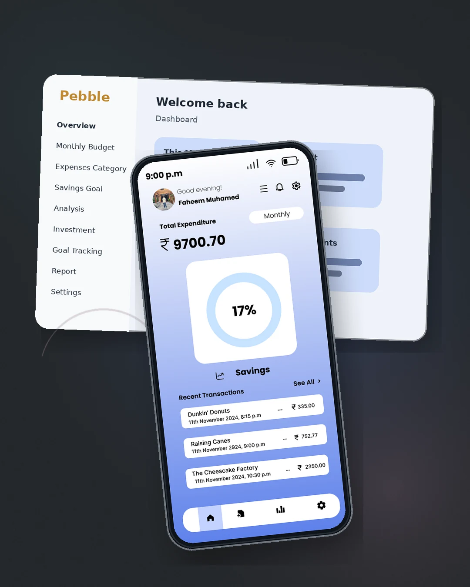

  
  

  
  
  

  
  

## 01 / A little about me

I’m a Computer Science graduate who likes the space between a user's problem and the system behind the screen. I move between interface decisions, everyday workflows and code — with a soft spot for products that make the next action feel obvious.

<table>
  <tr>
    <td width="50%" valign="top">
      <strong>ON THE DESK</strong> 
      Pebble — a personal-finance dashboard built around a useful first glance. 
      Loop — an expiry tracker that brings the next thing to use forward.
    </td>
    <td width="50%" valign="top">
      <strong>OPEN TO</strong> 
      Early-career opportunities in product, digital experience and business systems.
    </td>
  </tr>
</table>

## 02 / Selected work

<table>
  <tr>
    <td width="43%" valign="top">
      
    </td>
    <td width="57%" valign="top">
      <h3>01 — Pebble FLAGSHIP</h3>
      
<strong>A money dashboard that answers one question before anything else: where do I stand?</strong>

      
Pebble keeps total expenditure, savings progress and recent transactions in view, while leaving deeper account and goal detail one step further in.

      
<strong>A decision I’d defend:</strong> the first screen gives people orientation before asking them to manage anything. I chose a spend figure, one savings visual and recent activity over putting a full transaction form or a dense category breakdown at the top.

      
<code>Product design</code> <code>Personal finance</code> <code>Mobile + desktop</code>

      
<a href="https://www.figma.com/design/FQiqgxgS54b5FWyqdNRYPU/Pebble---your-complete-finance-ecosystem?node-id=0-1">Open Pebble in Figma</a>

    </td>
  </tr>
</table>

<table>
  <tr>
    <td width="50%" valign="top">
      <h3>02 — Loop</h3>
      

        
      

      
Loop is for people who lose track of what is already at home. Its Today screen puts the next action first: items needing attention, a short Use First list, and a reminder to check the cupboard before shopping again.

      
<code>Mobile UX</code> <code>Expiry tracking</code> <code>Waste reduction</code>

      
<a href="https://www.figma.com/design/PA0IUzzXziK4g2fI5Dh110/Loop---expiry-tracking-platform?node-id=2-70">Open Loop in Figma</a>

    </td>
    <td width="50%" valign="top">
      <h3>03 — EcoDrop</h3>
      

        
      

      
EcoDrop maps the journey for unwanted electronics: find a service, arrange a pickup or drop-off, follow the recycling hand-off and see reward points. The home screen brings the three main actions forward instead of making people work through a directory.

      
<code>Platform design</code> <code>E-waste</code> <code>Service flow</code>

      
<a href="https://www.figma.com/design/3b2Q5M4eULNU2Axh0GIHME/EcoDrop?node-id=0-1">Open EcoDrop in Figma</a>

    </td>
  </tr>
</table>

<table>
  <tr>
    <td width="34%" valign="top">
      
    </td>
    <td width="66%" valign="top">
      <h3>04 — LaunchPad</h3>
      
<strong>Resume review and career preparation</strong>

      
LaunchPad pairs an Android client built in Kotlin with a Python backend. The app screen shows a profile-progress view and current competencies. The public repository currently contains the backend prototype: it extracts text from PDF resumes, matches keywords to broad sectors, returns detected and missing skills, and provides interview and cover-letter templates.

      
<strong>Under the hood:</strong> the score is a keyword heuristic, not a validated ATS score; the interview and cover-letter outputs are templates, not generative-AI responses. The Android client source is not in the public repository yet.

      
<code>Kotlin</code> <code>Android Studio</code> <code>Python</code> <code>FastAPI</code> <code>PyMuPDF</code>

      
<a href="https://github.com/notreallyflash/LaunchPad">Open the LaunchPad repository</a>

    </td>
  </tr>
</table>

## 03 / Experience

<strong>Technology Consulting Intern</strong> · Emstell Technology Consulting · Kuwait 
<em>May – July 2025</em>

- Assisted in redesigning the company website’s UI and UX.
- Joined client meetings to gather requirements and contribute ideas tied to business goals.
- Worked with design and development teams to keep branding consistent across digital platforms.
- Researched competitors and the market to shape the redesign strategy and content plan.

## 04 / Education

<strong>Bachelor of Computer Applications (BCA), 2026</strong> 
Kristu Jayanti College (Deemed to be University) · Bengaluru, India

## 05 / Tools I reach for

- <strong>Languages & web:</strong> <code>Python</code> <code>Kotlin</code> <code>JavaScript</code> <code>HTML</code> <code>CSS</code>
- <strong>Backend & data:</strong> <code>FastAPI</code> <code>Supabase</code> <code>PyMuPDF</code> <code>Pydantic</code>
- <strong>Product & visual design:</strong> <code>Figma</code> <code>Canva</code>
- <strong>Build workflow:</strong> <code>Git</code> <code>GitHub</code> <code>VS Code</code> <code>Android Studio</code>
- <strong>Exploring:</strong> Docker · Google Cloud · Cloud and DevOps

---

<strong>Make the next step obvious.</strong>

<a href="https://notreallyflash.github.io/">Portfolio</a> · <a href="mailto:faheemhashim04@gmail.com">Say hello</a> · <a href="https://github.com/notreallyflash/LaunchPad">LaunchPad code</a>

