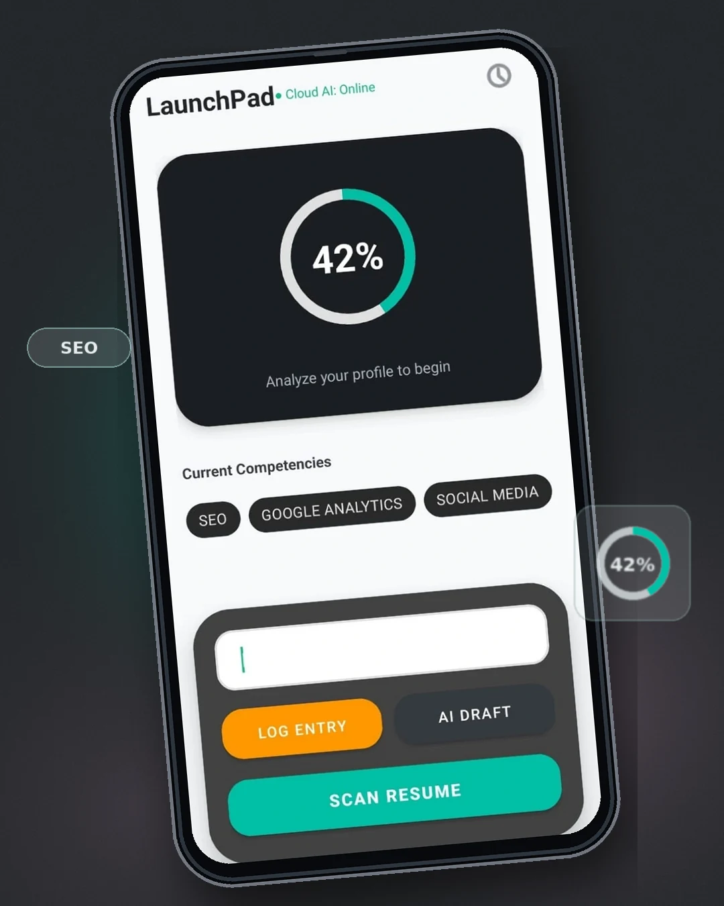

  
  

  
  
  

  
  

## a little about me

I’m a BCA graduate based in Kuwait. I like figuring out where an everyday task gets awkward, sketching a simpler flow, and building the pieces that make it work.

**Currently building:** Pebble + Loop &nbsp;·&nbsp; **Open to:** internships in product and digital experience.

BCA · Kristu Jayanti College (Deemed to be University), Bengaluru · 2026 &nbsp; / &nbsp; Technology Consulting Intern · Emstell Technology Consulting · May–July 2025

## selected work

<table>
  <tr>
    <td width="48%" valign="middle">
      
    </td>
    <td width="52%" valign="middle">
      <h3>01 / Pebble FLAGSHIP</h3>
      
<strong>A personal-finance dashboard built around one quick question: how are things looking?</strong>

      
The first screen brings together total expenditure, savings progress and recent transactions. Accounts, budgets and longer-term goals sit a step deeper.

      
<strong>My design call:</strong> keep the opening view easy to read at a glance — not a transaction form or a wall of categories.

      
<a href="https://www.figma.com/design/FQiqgxgS54b5FWyqdNRYPU/Pebble---your-complete-finance-ecosystem?node-id=0-1">Explore Pebble in Figma</a>

    </td>
  </tr>
</table>

<table>
  <tr>
    <td width="50%" valign="top">
      <h3>02 / Loop</h3>
      

        
      

      
An expiry tracker for the things already at home. The Today screen pulls soon-to-expire items into <strong>Use First</strong> and prompts a quick check before the next shop.

      
<a href="https://www.figma.com/design/PA0IUzzXziK4g2fI5Dh110/Loop---expiry-tracking-platform?node-id=2-70">View the Figma flow</a>

    </td>
    <td width="50%" valign="top">
      <h3>03 / EcoDrop</h3>
      

        
      

      
An e-waste recycling concept that takes people from finding a service to arranging collection, following the recycler hand-off and seeing reward points.

      
<a href="https://www.figma.com/design/3b2Q5M4eULNU2Axh0GIHME/EcoDrop?node-id=0-1">View the Figma flow</a>

    </td>
  </tr>
</table>

<table>
  <tr>
    <td width="34%" valign="middle">
      
    </td>
    <td width="66%" valign="middle">
      <h3>04 / LaunchPad</h3>
      
A career-prep app pairing an Android client (Kotlin) with a Python/FastAPI backend prototype. The backend reads PDF resumes, matches keywords and returns skill feedback; interview and cover-letter endpoints currently use templates.

      
The score is a keyword heuristic, not a validated ATS score. The Android client source is not in the public repository yet.

      
<a href="https://github.com/notreallyflash/LaunchPad">Explore the code on GitHub</a>

    </td>
  </tr>
</table>

## the toolkit

- **Build:** `Python` `Kotlin` `JavaScript` `HTML` `CSS` `FastAPI` `Supabase`
- **Design:** `Figma` `Canva`
- **Workflow:** `Git` `GitHub` `VS Code` `Android Studio`
- **Exploring:** Cloud & DevOps · workflow automation

<strong>Curious by nature. Building with intent.</strong>

