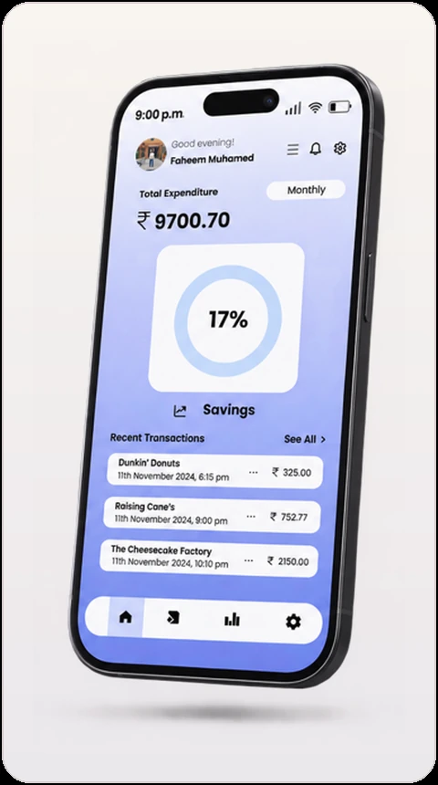
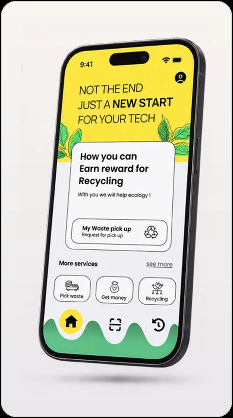

  

  
  

## a little about me

CS grad based in Kuwait—designing interfaces in Figma and building backends in Python. Right now, I’m focused on shipping Pebble and Loop.

- **Currently working on:** Pebble — a personal-finance experience built around a clearer view of spending and savings.
- **Open to:** Product Engineering, UI/UX Design, Frontend and Full-Stack internships.

Kristu Jayanti(Deemed to be University) · Bengaluru, India · 2026 &nbsp; / &nbsp; Summer Intern · Emstell Technology Consulting · May–July 2025

## selected work

<table>
  <tr>
    <td width="30%" valign="middle">
      
    </td>
    <td width="70%" valign="middle">
      <h3>01 / Pebble FLAGSHIP</h3>
      
<strong>A personal-finance dashboard that answers one question first: how are things looking?</strong>

      
The home screen brings monthly expenditure, savings progress and recent transactions together. Deeper account and goal details sit one step further in.

      
<strong>My design call:</strong> lead with orientation, not data entry. A spend figure, one savings visual and recent activity help people get their bearings before asking them to log or categorise anything.

      
Design prototype · Personal finance · Mobile UI

      
<a href="https://www.figma.com/design/FQiqgxgS54b5FWyqdNRYPU/Pebble---your-complete-finance-ecosystem?node-id=0-1">Explore Pebble in Figma</a>

    </td>
  </tr>
</table>

<table>
  <tr>
    <td width="30%" valign="middle">
      
    </td>
    <td width="70%" valign="middle">
      <h3>02 / LaunchPad</h3>
      
<strong>A career-preparation app with an Android interface and a public Python backend.</strong>

      
The Android UI brings resume scanning, core competencies and follow-up actions into one flow. The public FastAPI backend extracts text from PDF resumes, matches sector and skill keywords, and returns heuristic feedback. Interview and cover-letter endpoints currently return templates.

      
<strong>My product call:</strong> make “Scan new resume” the clearest action, while keeping record-saving and drafting tools close by.

      
Android client in private refinement · Public backend prototype

      
<a href="https://github.com/notreallyflash/LaunchPad">Explore the LaunchPad code</a>

      
Accuracy note: the 28% shown in this UI visual is not the score returned by the current public backend. The backend uses a separate keyword-based heuristic, not a validated ATS score.

    </td>
  </tr>
</table>

<table>
  <tr>
    <td width="30%" valign="middle">
      
    </td>
    <td width="70%" valign="middle">
      <h3>03 / EcoDrop</h3>
      
<strong>An e-waste service concept that makes the handover of old electronics feel straightforward.</strong>

      
People can start with a pickup request, explore recycling services and see the reward route for returning unwanted devices.

      
<strong>My design call:</strong> put pickup and rewards ahead of an impact dashboard. First make it obvious how to hand over an old device and what the user gets in return; environmental impact can support that action rather than compete with it.

      
Figma concept · Service design · E-waste

      
<a href="https://www.figma.com/design/3b2Q5M4eULNU2Axh0GIHME/EcoDrop?node-id=0-1">Explore EcoDrop in Figma</a>

    </td>
  </tr>
</table>

## the toolkit

- **Build:** `Python` `Kotlin` `FastAPI` `PyMuPDF` `SQL` `JavaScript` `HTML` `CSS`
- **Design:** `Figma`
- **Workflow:** `Git` `GitHub` `VS Code` `Android Studio`
- **Exploring:** `React` `Next.js` `Docker` `Google Cloud`

<strong>Have a problem worth making simpler?</strong> 
<a href="mailto:faheemhashim04@gmail.com">Say hello</a>

