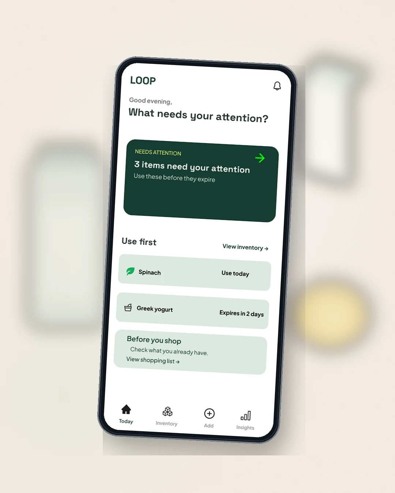
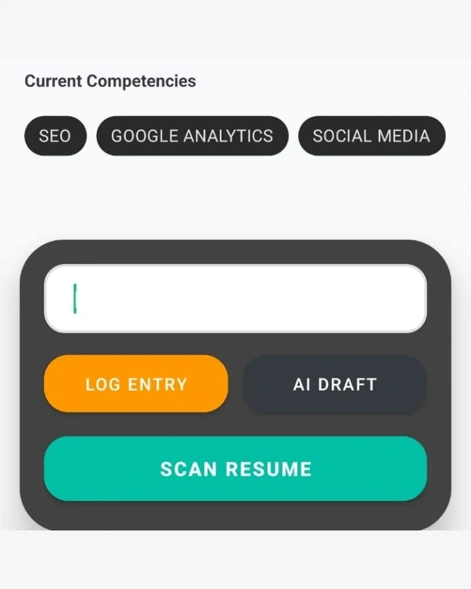

  
  

  
  
  

## a little about me

I’m a **Bachelor of Computer Applications** graduate based in Kuwait. I like spotting where everyday tasks get awkward, sketching a simpler path, and building the pieces behind it.

**Currently building:** Pebble + Loop &nbsp;·&nbsp; **Open to:** internships in product and digital experience.

Kristu Jayanti College (Deemed to be University) · Bengaluru, India · 2026 &nbsp; / &nbsp; Technology Consulting Intern · Emstell Technology Consulting · May–July 2025

## selected work

<table>
  <tr>
    <td width="35%" valign="middle">
      
    </td>
    <td width="65%" valign="middle">
      <h3>01 / Pebble FLAGSHIP</h3>
      
<strong>A personal-finance dashboard built around one quick question: how are things looking?</strong>

      
The first screen brings total expenditure, savings progress and recent transactions together. Accounts, budgets and longer-term goals sit a step deeper.

      
<strong>My design call:</strong> show people where they stand before asking them to manage anything. I kept the opening view to a spend figure, one savings visual and recent activity — not a transaction form or a wall of categories.

      
<a href="https://www.figma.com/design/FQiqgxgS54b5FWyqdNRYPU/Pebble---your-complete-finance-ecosystem?node-id=0-1">Explore Pebble in Figma</a>

    </td>
  </tr>
</table>

<table>
  <tr>
    <td width="35%" valign="middle">
      
    </td>
    <td width="65%" valign="middle">
      <h3>02 / Loop</h3>
      
An expiry tracker for the things already at home. The Today screen pulls soon-to-expire items into <strong>Use First</strong> and prompts a quick check before the next shop.

      
<strong>My design call:</strong> put Use First ahead of the full inventory. When someone opens Loop, the useful question is “what should I use next?” — not “what do I own?”

      
<a href="https://www.figma.com/design/PA0IUzzXziK4g2fI5Dh110/Loop---expiry-tracking-platform?node-id=2-70">Explore Loop in Figma</a>

    </td>
  </tr>
</table>

<table>
  <tr>
    <td width="35%" valign="middle">
      
    </td>
    <td width="65%" valign="middle">
      <h3>03 / EcoDrop</h3>
      
An e-waste recycling concept that takes people from finding a service to arranging collection, following the recycler hand-off and earning rewards.

      
<strong>My design call:</strong> put pickup and the money/reward route up front instead of leading with an impact dashboard. First, make it easy to hand an old device over and clear what the user gets back; the environmental benefit supports that action.

      
<a href="https://www.figma.com/design/3b2Q5M4eULNU2Axh0GIHME/EcoDrop?node-id=0-1">Explore EcoDrop in Figma</a>

    </td>
  </tr>
</table>

<table>
  <tr>
    <td width="35%" valign="middle">
      
    </td>
    <td width="65%" valign="middle">
      <h3>04 / LaunchPad</h3>
      
A career-prep app pairing a Kotlin Android client with a Python/FastAPI backend prototype. The public repository contains the backend: PDF text extraction, keyword-based sector and skill matching, a heuristic feedback score, and templated interview and cover-letter endpoints.

      
The Android client source is not in the public repository yet. The screenshot is cropped to the competencies and action area, leaving out the inconsistent sample progress indicator.

      
<a href="https://github.com/notreallyflash/LaunchPad">Explore the code on GitHub</a>

    </td>
  </tr>
</table>

## the toolkit

- **Build:** `Python` `Kotlin` `JavaScript` `HTML` `CSS` `FastAPI` `PyMuPDF`
- **Design:** `Figma` `Canva`
- **Workflow:** `Git` `GitHub` `VS Code` `Android Studio`
- **Exploring:** Cloud & DevOps · workflow automation

<strong>Have something worth making simpler?</strong> 
<a href="https://notreallyflash.github.io/">See my portfolio</a> &nbsp;·&nbsp; <a href="mailto:faheemhashim04@gmail.com">Say hello</a>

