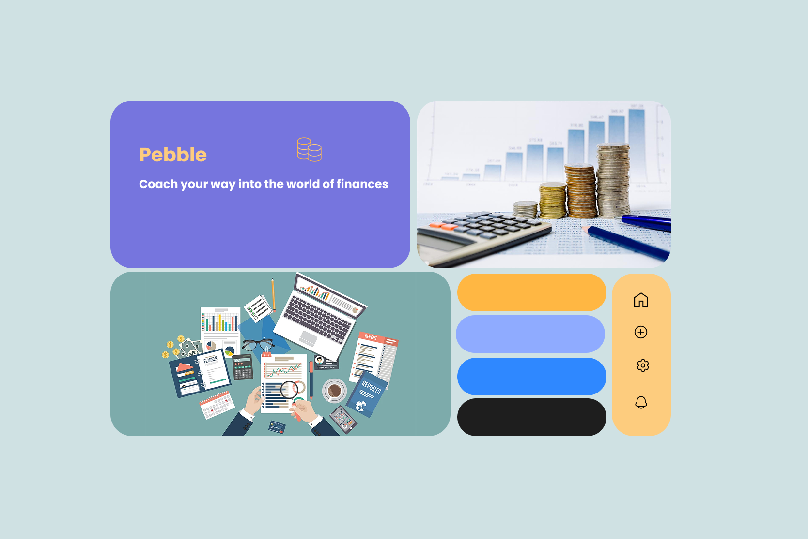
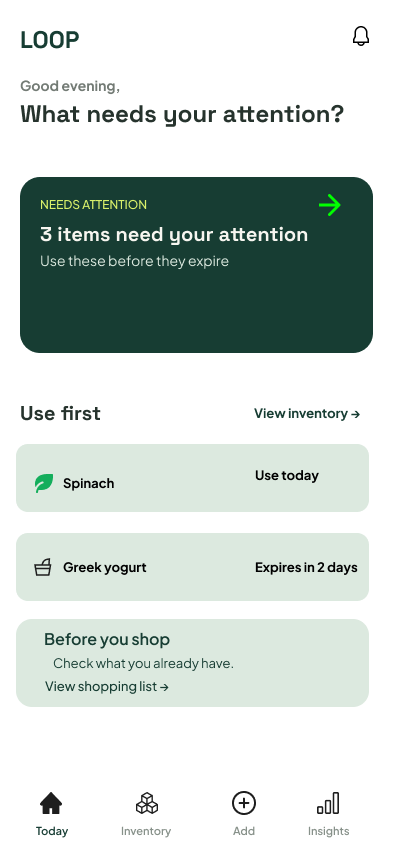
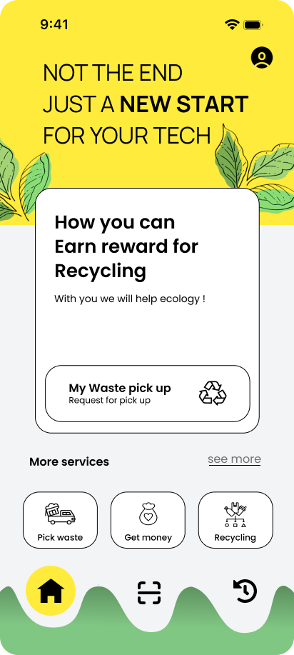

  
  

  
  
  

  
  
  

## 01 / A little about me

I’m a Computer Science graduate who enjoys both sides of making a product: deciding how a screen should work and figuring out what needs to happen behind it. Most of my recent work has been in Figma, with LaunchPad giving me a place to build the backend side too.

<table>
  <tr>
    <td width="33%" valign="top"><strong>On the desk</strong> Pebble · Loop</td>
    <td width="33%" valign="top"><strong>Interested in</strong> Product work · digital systems · practical software</td>
    <td width="33%" valign="top"><strong>Currently learning</strong> Cloud · DevOps · workflow automation</td>
  </tr>
</table>

## 02 / Selected work

A few things I’ve been designing and building. The first three are product/UI concepts; LaunchPad has a public backend repository.

<table>
  <tr>
    <td width="50%" valign="top">
      
      <h3>01 / Pebble</h3>
      
 

      
Pebble is for people who want to see their money at a glance without losing track of bigger goals. I’ve put balance, accounts, goal progress and recent activity on the first dashboard; budgets, categories, investments and reports are there when you want to dig in.

      
<a href="https://www.figma.com/design/FQiqgxgS54b5FWyqdNRYPU/Pebble---your-complete-finance-ecosystem?node-id=0-1">Open the Pebble Figma file &rarr;</a>

    </td>
    <td width="50%" valign="top">
      
      <h3>02 / Loop</h3>
      
 

      
Loop is about the food and everyday items that get forgotten at the back of a cupboard. Its Today screen brings expiring items into a Needs Attention panel and a Use First list. The Before You Shop prompt is there to help people check what they already have before buying more.

      
<a href="https://www.figma.com/design/PA0IUzzXziK4g2fI5Dh110/Loop---expiry-tracking-platform?node-id=2-70">Open the Loop Figma file &rarr;</a>

    </td>
  </tr>
  <tr>
    <td width="50%" valign="top">
      
      <h3>03 / EcoDrop</h3>
      
 

      
EcoDrop gives e-waste a clear route out of the drawer: identify an item, request collection, follow the recycler and collect points. The home screen puts pickup, getting money and recycling up front, instead of hiding the useful actions behind a generic impact dashboard.

      
<a href="https://www.figma.com/design/3b2Q5M4eULNU2Axh0GIHME/EcoDrop?node-id=0-1">Open the EcoDrop Figma file &rarr;</a>

    </td>
    <td width="50%" valign="top">
      <h3>04 / LaunchPad</h3>
      
 

      <pre>PDF resume
   ↓
text extraction
   ↓
sector + skill matching
   ↓
strengths · gaps · feedback</pre>
      
LaunchPad started as an Android career-prep app. The public repository is currently the Python backend: it extracts text from a PDF resume, compares it with role keywords and returns skills found, gaps, a rough score and an improvement tip. Separate routes return basic interview-prep and cover-letter templates.

      
The current resume score is a keyword-based estimate, not a validated ATS score. The interview and cover-letter routes return fixed templates. The Android client is not in the public repository yet.

      
<a href="https://github.com/notreallyflash/LaunchPad">Explore the LaunchPad repository &rarr;</a>

    </td>
  </tr>
</table>

## 03 / Experience

<table>
  <tr>
    <td width="34%" valign="top"><strong>Technology Consulting Intern</strong> Emstell Technology Consulting Kuwait · May–July 2025</td>
    <td valign="top">
      <ul>
        <li>Helped rethink the UI/UX of the company website.</li>
        <li>Sat in on client meetings, clarified requirements and shared ideas.</li>
        <li>Worked with the design and development teams to keep the digital look consistent.</li>
        <li>Researched competitor websites and market references to help shape the redesign and content.</li>
      </ul>
    </td>
  </tr>
</table>

## 04 / Education

<strong>Computer Science</strong> 
Kristu Jayanti (Deemed to be University) · Bengaluru, Karnataka, India

## 05 / Tools in the mix

<table>
  <tr>
    <td width="50%" valign="top"><strong>Code</strong> <code>Python</code> <code>Kotlin</code> <code>JavaScript</code> <code>HTML</code> <code>CSS</code></td>
    <td width="50%" valign="top"><strong>Backend</strong> <code>FastAPI</code> <code>Supabase</code> <code>PyMuPDF</code></td>
  </tr>
  <tr>
    <td width="50%" valign="top"><strong>Design</strong> <code>Figma</code> <code>Canva</code></td>
    <td width="50%" valign="top"><strong>Workflow</strong> <code>Git</code> <code>GitHub</code> <code>VS Code</code> <code>Android Studio</code></td>
  </tr>
</table>

Exploring next: Docker, Google Cloud Platform and DevOps practices.

---

<strong>Curious by nature. Building with intent.</strong>

<a href="mailto:faheemhashim04@gmail.com">Say hello</a> &nbsp;·&nbsp; <a href="https://github.com/notreallyflash?tab=repositories">Browse the projects</a>

