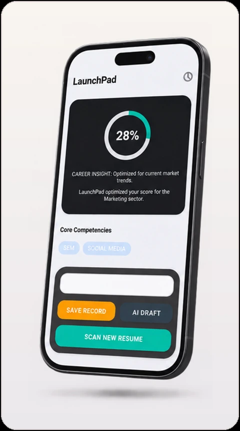

  

  

## a little about me

CS grad based in Kuwait—designing interfaces in Figma and building backends in Python. Right now, I’m focused on shipping Pebble and Loop.

- **Currently working on:** Pebble — a personal-finance experience built around a clearer view of spending and savings.
- **Open to:** Product Engineering, UI/UX Design, Frontend and Full-Stack internships.

Kristu Jayanti(Deemed to be University) · Bengaluru, India · 2026 &nbsp; / &nbsp; Summer Intern · Emstell Technology Consulting · May–July 2025

## selected work

<table>
  <tr>
    <td width="30%" valign="middle">
      
    </td>
    <td width="70%" valign="middle">
      <h3>01 / Pebble FLAGSHIP</h3>
      
A personal finance app for tracking expenses, managing budgets, savings goals, investments and transactions, with a home screen designed for quick check-ins.
      

      
Design prototype · Personal finance · Mobile UI

      
<a href="https://www.figma.com/design/FQiqgxgS54b5FWyqdNRYPU/Pebble---your-complete-finance-ecosystem?node-id=0-1">Explore Pebble in Figma</a>

    </td>
  </tr>
</table>

<table>
  <tr>
    <td width="30%" valign="middle">
      
    </td>
    <td width="70%" valign="middle">
      <h3>02 / LaunchPad</h3>
      

      A career-prep app that evaluates resumes against target roles to pinpoint
      skill gaps and generate tailored interview and cover-letter prep.
      

      
<a href="https://github.com/notreallyflash/LaunchPad">Explore the LaunchPad code</a>

      
Accuracy note: the 28% shown in this UI visual is not the score returned by the current public backend. The backend uses a separate keyword-based heuristic, not a validated ATS score.

    </td>
  </tr>
</table>

<table>
  <tr>
    <td width="30%" valign="middle">
      
    </td>
    <td width="70%" valign="middle">
      <h3>03 / EcoDrop</h3>
      

      An e-waste recycling app that helps users identify unwanted electronics,
      arrange pickups, track recycling progress and earn rewards for responsible disposal.
      

      
Figma concept · Service design · E-waste

      
<a href="https://www.figma.com/design/3b2Q5M4eULNU2Axh0GIHME/EcoDrop?node-id=0-1">Explore EcoDrop in Figma</a>

    </td>
  </tr>
</table>

## the toolkit

- **Build:** `Python` `Kotlin` `FastAPI` `PyMuPDF` `SQL` `JavaScript` `HTML` `CSS`
- **Design:** `Figma`
- **Workflow:** `Git` `GitHub` `VS Code` `Android Studio`
- **Exploring:** `React` `Next.js` `Docker` `Google Cloud`

<strong>Have a problem worth making simpler?</strong> 
<a href="mailto:faheemhashim.work@gmail.com">Say hello</a>

