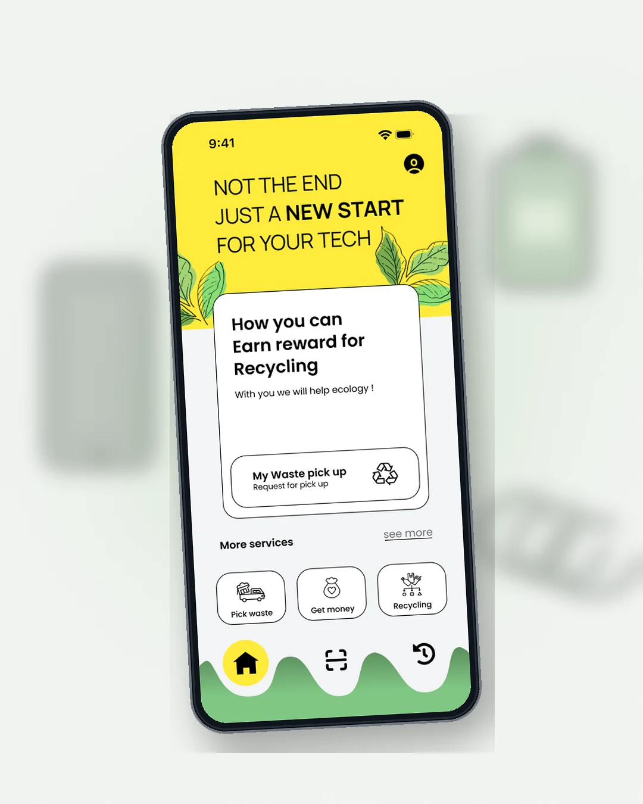

  

  
  

## a little about me

I’m a **Bachelor of Computer Applications** graduate based in Kuwait. I like spotting where everyday tasks get awkward, sketching a clearer flow, and figuring out how to make it work.

- **Currently building:** Pebble & Loop — moving selected Figma flows into Next.js and Kotlin builds.
- **Open to:** Product Engineering, UI/UX Design, Frontend and Full-Stack internships.

Kristu Jayanti College (Deemed to be University) · Bengaluru, India · 2026 &nbsp; / &nbsp; Technology Consulting Intern · Emstell Technology Consulting · May–July 2025

## selected work

### 01 / Pebble FLAGSHIP

  

A personal-finance dashboard that answers one quick question first: **how are things looking?** Monthly expenditure, savings progress and recent transactions sit up front; accounts, budgets and longer-term goals sit a step deeper.

**My design call:** lead with orientation, not data entry. A spend figure, one savings visual and recent activity help people get their bearings before asking them to log or categorise anything.

[Explore Pebble in Figma](https://www.figma.com/design/FQiqgxgS54b5FWyqdNRYPU/Pebble---your-complete-finance-ecosystem?node-id=0-1)

---

### 02 / Loop

  

Loop helps people keep track of food and everyday items already at home. Its Today screen brings soon-to-expire items forward, with a **Use First** list and a reminder to check what is on hand before shopping.

**My design call:** put Use First ahead of the full inventory. When someone opens Loop, the useful question is “what should I use next?” — not “what do I own?”

[Explore Loop in Figma](https://www.figma.com/design/PA0IUzzXziK4g2fI5Dh110/Loop---expiry-tracking-platform?node-id=2-70)

---

### 03 / EcoDrop

  

EcoDrop maps the handover of unwanted electronics — from finding a service and arranging collection to following the recycler hand-off and seeing reward points.

**My design call:** put pickup and the reward route up front instead of leading with an impact dashboard. Make the next step and practical return clear first; the environmental benefit is the reason behind the service, not another chart to interpret.

[Explore EcoDrop in Figma](https://www.figma.com/design/3b2Q5M4eULNU2Axh0GIHME/EcoDrop?node-id=0-1)

---

### 04 / LaunchPad · Code

  

A career-preparation app pairing an Android client with a Python/FastAPI backend. The public repository houses the backend: PDF parsing, keyword-based skill matching, heuristic feedback scoring, and interview-preparation and cover-letter endpoints. The Android client is currently in private refinement.

**Code:** [LaunchPad on GitHub](https://github.com/notreallyflash/LaunchPad) · `Python` `FastAPI` `PyMuPDF` `Kotlin`

## the toolkit

- **Build:** `Python` `Kotlin` `JavaScript` `React` `Next.js` `HTML` `CSS` `SQL` `FastAPI` `Supabase`
- **Design:** `Figma`
- **Workflow:** `Git` `GitHub` `VS Code` `Android Studio`
- **Exploring:** `Docker` `Google Cloud` · Cloud & DevOps · workflow automation

<strong>Have a problem worth making simpler?</strong> 
<a href="mailto:faheemhashim04@gmail.com">Say hello</a>

